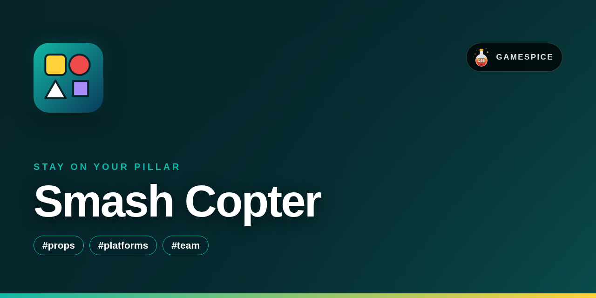

This is a game to demonstrate the capabilities of the [**GameSpice collection**](https://gamespice.net) built on-top of [Godot 4](https://godotengine.org/) and [**GameSpice**](https://gamespice.net). In this 3D game, players spawn on top of platforms balanced on single pillars while a cannon in the middle shoots props up into the air that may knock them off. Players must survive in teams or individually to win (depending on server setup). This is heavily inspired off of a classic Counter-Strike: Source MiniGames map called [**mg_3k_smash_lego_copter**](https://gamebanana.com/mods/127650) ([gameplay video](https://www.youtube.com/watch?v=xZED7S1dfBY)).


*Play on the test server [here](https://moddingcommunity.com/godot/s/smash01/play).*

A server holds 24 players by default (`max_players` in `game.yml`).

**This project and the assets under it are COMPLETELY OPEN SOURCE**. You are free to use, modify, and distribute them under the terms of the MIT license. The only thing not open source is the back-end web infrastructure. So if you opt into using your own authentication backend instead of integrating with GameSpice, you will need to build and integrate your own back-end infrastructure.

This game was built with Claude Code and has had little testing with real players, so please report anything odd you run into.

## How it plays
A round has two halves.

**The first two minutes are about keeping your footing.** Two teams by default (a server can set any number, as many as fit round the corners) stand on platforms balanced on single pillars, 40 metres up. Nobody can hurt anybody. A platform leans toward whoever is standing on it, and past about 16 degrees it comes off its pillar and takes everybody on it down to the floor. Meanwhile a cannon in the middle aims at the platforms that are still up and throws props at them, getting heavier as the round goes on:

| Tier | Props | What it does to a platform |
| --- | --- | --- |
| 1 | Crate, tyre, cone | Wobbles it |
| 2 | Barrel, boulder | Tips it. A barrel also explodes |
| 3 | Container, slab | Knocks a corner off it |
| 4 | Monolith | Destroys it, with everybody on it |

**Shift is a brake, not a sprint.** Running is the default speed, and running is what tips a platform. A running player leans it about three times as far as a standing one, so the way to cross a platform somebody else is standing on is to slow down.

**The last 90 seconds are a fight.** Everybody still standing is teleported to a corner pad in the sky with random weapons from [zee-gs-weapons](https://github.com/zees-games/zee-gs-weapons). Catwalks join the corners to a ring in the middle. The last team standing wins.

About a third of rounds (34% by default) are **special rounds**, which change the rules for a while: `barrage`, `heavy`, `feather` (low gravity), `slick` (ice), `gale` (wind), `quake`, `jelly` (loose pillars), `downpour` and `rush`. Two can overlap.

The field is re-rolled every round from 11 **layouts**, from the full grid down to two islands: `full`, `checker`, `islands`, `spine`, `airfield`, `gauntlet`, `broadside`, `hollow`, and three bigger ones with more than one flat level, `terraces` (stepped ramps), `ring` (a ring of decks round the tube, with corner towers) and `watchtowers` (two towers joined by bridges). Every piece is a platform, a bridge or a tower and falls the way platforms do. You can stand on the chopper and be carried by it. The layouts are listed and voted through [gs-map](https://github.com/gamespice-platform/map) like the other games (M). Two of them park a **chopper**: the pilot flies it with the movement keys and drops crates on whatever is underneath, and the passenger can shoot.

When you fall, you are out until the next round and watch somebody on your own side who is still up.

## Controls

| Key | Action |
| --- | --- |
| **WASD** | Move. In the chopper: W/S tilt forward and back, A/D turn |
| **Shift** | Walk (the brake) |
| **Space** / **Ctrl** | Jump / crouch. In the chopper: up / down |
| **F** | Flashlight, while still up (starts off: the sky is lit). A lit beam is seen by everyone who can see you |
| **E** | Get into or out of the chopper |
| **Mouse 1** | Fire (in the showdown). In the chopper: drop a crate |
| **1**-**5** | Weapon slots (in the showdown) |
| **F5** | First or third person |
| **Y** / **U** | Chat / chat to your side |
| **V** | Push to talk |
| **H** | Help: the rules and every key as you have it bound |
| **Esc** | Menu: settings (every key above can be rebound), help, and leave |

While you are out: **Mouse 1** / **Mouse 2** watch the next or previous player, and **F5** switches between their eyes and behind them (if the server allows it).

## Getting started
You need [Godot 4.7](https://godotengine.org/download). The game is built from many GameSpice addons, each in its own repository, so the easiest way to get everything is [gs-bootstrap](https://github.com/gamespice-platform/bootstrap). It clones every project and links the addons into each one:

```bash
git clone https://github.com/gamespice-platform/bootstrap.git
cd gs-bootstrap
./bootstrap.sh
cd projects/mg-smash-copter
./game.sh
```

On Windows, run `bootstrap.ps1` instead and open the project in Godot.

`game.sh` does everything else:

| Command | What it does |
| --- | --- |
| `./game.sh` | Play offline against bots |
| `./game.sh online` | Start a local server and the browser client, and print the link to open |
| `./game.sh online down` | Stop them |
| `./game.sh server` | Start a local dedicated server only |
| `./game.sh test` | Check every script and run every test suite |
| `./game.sh shot` | Save a screenshot to `screenshots/`. `./game.sh shot --help` lists the views |
| `./game.sh help` | All of the options |

`online` and `server` use [gs-server-deploy](https://github.com/gamespice-platform/server-deploy), which bootstrap clones next to this one. Run its `./setup.sh` once first.

## Running a server
Settings are cvars (or environment variables like `SC_LAYOUT_IDS`). Set them in the server's config, on the command line, or live from the console. Most of them take effect straight away.

```
sc_survival_seconds 120     // length of the first half (default 120)
sc_showdown_seconds 90      // length of the fight
sc_teams 2                  // number of sides (default 2, any value of 2 or more that fits round sc_corner_distance; past six the colours are generated)
sc_stiffness 7.0            // lower is wobblier
sc_motion_gain 2.0          // how much more a running player tips a platform than a walking one
sc_cannon_interval 1.9      // seconds between shots
sc_cannon_max_tier 4        // 2 = nothing that destroys a platform outright
sc_special_chance 34        // percent of rounds that are special
sc_chopper 1                // 0 = no chopper on any layout
mp_teammate_passthrough 1   // shots and team-mates: 0 a team-mate is hit and blocks, 1 through one at the muzzle, 2 through every team-mate
bot_quota 4                 // players a round is kept at with bots; each person who joins replaces one
bot_quota_mode fill         // fill (as above), fixed (that many bots), per_player (that many per person) or off
sc_bots 1                   // 0 = no automatic bots at all
bot_difficulty medium       // easy, medium, hard or nightmare: how bots turn, aim and react (every bot_* setting)
sc_bot_advance 200          // how far a bot walks toward a fight in the showdown, metres (default 200, any value of 5 or more)
sc_bot_lean_notice 1.15     // degrees of lean a bot feels before it walks uphill (higher is clumsier; default 1.15, any value of 0 or more)
sc_bot_spray 0.6            // metres of miss a bot accepts when it fires (higher sprays from further; default 0.6, any value of 0.1 or more)
mp_forcecamera 0            // who somebody out may watch: 0 = anybody, 1 = own side only, 2 = nobody (sc_spectate_camera is the old name)
mp_freeroam 1               // 1 = somebody out may fly a free camera (G); any mp_forcecamera above 0 turns it off
mp_freeroam_speed 12        // metres per second of the free camera
```

The bot count cvars are the family's shared ones (gs-server's `GSBotQuota`), and so are `bot_difficulty` and every `bot_*` setting (gs-bot; `bot_settings` lists them). `sc_min_players` still works and sets `bot_quota`, and `sc_bot_spread` sets `bot_aim_error`; both are deprecated. Solo, the same names are at the console, and `./game.sh -- --bot_difficulty hard` sets the preset at launch.

Dead players fall as ragdolls ([gs-player-char](https://github.com/gamespice-platform/player-char)); the server picks how each one goes down and everybody sees the same fall. `sv_ragdoll 0` makes it a quick fall with no physics, `sv_ragdoll_style` picks ragdoll, stiff, topple or hide, `sv_ragdoll_time` and `sv_ragdoll_max` say how long and how many, and `sv_ragdoll_reactions` weights the falls (`limp`, `face_plant`, `crumple`, `headshot_launch`, `power_launch`; 0 turns one off).

`mp_teammate_passthrough` is the family's shared one from gs-combat, live from the next shot. At 2 a team-mate in the line never stops a shot; splash still reaches them.

`--sc-layout-ids=checker` (or `SC_LAYOUT_IDS=checker`) plays one layout all evening. An empty server fills itself with bots, because a round needs two sides.

Console commands: `sc_status`, `sc_net`, `sc_layouts` and `sc_specials`.

### Admin commands
These come from [gs-moderation](https://github.com/gamespice-platform/moderation): `noclip`, `freeze`, `speed`, `gravity`, `god`, `buddha`, `hp`, `slay`, `slap`, `rename` and the teleports. `blind <player> [on|off|seconds]` blacks out that player's screen, and `beacon <player> [on|off]` puts a ring and a ping on them for everybody. `respawn`, `give` and `strip` are turned off, and `modtools` says why.

### Stats and achievements
The server counts rounds survived, showdowns won, people knocked out in the corners, falls, platforms you tipped, and props that landed on your platform and missed you. Achievements are built on those. They are kept in memory unless the server sets `SC_PROGRESS_DIRECTORY`, and only reported to the website with `SC_REPORT_PROGRESS` and a credential.

## Testing

```bash
./game.sh test                  # every script parses, then every suite runs
./game.sh test headless_run     # one suite
```

| Suite | What it covers |
| --- | --- |
| `headless_run` | The game itself: platforms, the cannon, layouts, special rounds, the showdown and bots |
| `headless_net` | A server and a client in one process, over the network code |
| `dedicated` | A real server: boots, loads the game, runs its commands |

[`CLAUDE.md`](CLAUDE.md) has the design decisions and the reasoning behind them.

## Credits

| Asset | Author / source | License | Where |
| --- | --- | --- | --- |
| Surfaces | Kenney, Prototype Textures | CC0 | each kit's licence |
| Things the cannon throws, tower railings | Kenney, Survival Kit and Car Kit | CC0 | each kit's licence |
| Chopper fuselage | Modified pod from Kenney's Space Kit; `art-src/build_copter.py`; rotors drawn in code | CC0 | `assets/models/CREDITS.md` |
| Players | Quaternius, [Zombie Apocalypse Kit](https://quaternius.com/packs/zombieapocalypsekit.html) | CC0 1.0 | gs-player-char |
| Weapons | [zee-gs-weapons](https://github.com/zees-games/zee-gs-weapons) | see that repo | that repo |
| Toys | [gs-props](https://github.com/gamespice-platform/props) beach balls, drawn in code; sounds by Kenney | CC0 | `addons/gs_props/toys/sounds/CREDITS.md` |
| Footsteps | Kenney, Impact Sounds | CC0 | `addons/gs_audio/stock/CREDITS.md` |
| Ambience beds | Generated by gs-audio | CC0 | `addons/gs_audio/stock/CREDITS.md` |
| Godot logo (boot splash) | Andrea Calabro, [godotengine.org/press](https://godotengine.org/press/) | CC BY 4.0 | `branding/splash.png` |

If you made one of these assets and want it removed, open an issue.

## License
MIT. See [LICENSE](LICENSE). The Kenney art is CC0, which is public domain.
